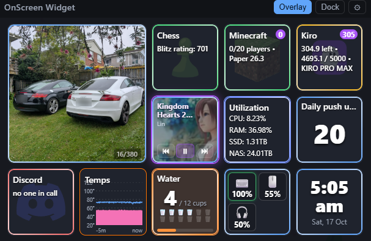

# OnScreen Widget

A lightweight desktop widget that monitors hardware temperatures, Bluetooth
batteries, services, prices and channels — built with **Tauri 2** (Rust backend) + **React/TypeScript**
frontend. Designed to be fast, low-memory, and run on modest hardware.



Windows 11 first; macOS supported by the same codebase (Tauri handles the
platform layer, and the OS-specific action code already branches for macOS).

---

## Hardware sensors

The **metrics** and **graph** tiles can track real hardware sensors — CPU cores,
motherboard, GPU, RAM and drives, plus **fan speeds, voltages, clocks, power draw,
usage, and current**. Readings come from a small bundled helper
(`sensor-helper/`, a .NET 8 console app built on
[LibreHardwareMonitorLib](https://github.com/LibreHardwareMonitor/LibreHardwareMonitor),
MPL-2.0, restored from NuGet at build time). The widget starts it automatically,
reads full-precision values twice a second, and stops it on exit — nothing to
install or configure.

Requirements (Windows):

- **.NET 8 runtime** on the machine running the app.
- Run the widget **as administrator** to read CPU, motherboard and RAM sensors
  (the helper loads a signed ring-0 driver). `run-dev.bat` requests elevation
  for you; without it, those sensors are simply omitted (GPU and drives still work).
- Temperature graph tiles use a fixed **20–120 °C** scale over a **5-minute** window.

If the helper isn't available, the widget falls back to the **LibreHardwareMonitor
web server** (Options → "Remote Web Server" → Run, port 8085), and then to the
OS sensors exposed by `sysinfo`.

In a metrics/graph tile, add a metric and choose a source:
- **Temperature °C** — temperature sensors only, plus a synthesized
  **CPU Core Max** (hottest CPU core). Simple when you just want temps.
- **Hardware sensor** — *every* detected sensor, annotated with its unit, e.g.
  **GPU Core — °C**, **GPU Hot Spot — °C**, **CPU Package — °C**, fan RPM,
  clocks, power, etc. The unit and label are auto-filled when you pick one.

Use **Refresh sensors** to re-scan, and **Diagnose LibreHardwareMonitor** to
check reachability and dump a sample of readings if the list is empty.

---

## Features

| Tile kind      | What it checks / does                                               | Status |
| -------------- | ------------------------------------------------------------------- | ------ |
| Hardware temps | Graph/metrics tiles for CPU cores, GPU, motherboard, RAM, drives    | ✅ working |
| Bluetooth      | Battery % and charging state for chosen devices (incl. Logitech HID++ and 2.4 GHz keyboards) | ✅ working |
| Water intake   | Click to log a cup; rolling 24 h window, goal progress, colour per quarter | ✅ working |
| Fitness counter | Click to add 5; daily reset, lifetime total on hover               | ✅ working |
| Date & time    | Clock tile; click opens the Windows calendar                        | ✅ working |
| Media          | System media controls (play/pause/next) via Windows SMTC            | ✅ working |
| Slideshow      | Cycles images/videos from a folder                                  | ✅ working |
| Minecraft      | Java Server List Ping — online, player count, version               | ✅ working |
| NAS / TCP      | Raw TCP connect to host:port                                        | ✅ working |
| Jellyfin       | `/System/Info/Public` reachability + server name/version            | ✅ working |
| Website / HTTP | HTTP(S) status check (configurable expected code)                   | ✅ working |
| Price tracker  | CSS-selector price extraction, history, drop/sale highlight         | ✅ working |
| YouTube        | Public RSS feed — upload count badge + latest title; click actions  | ✅ working |
| Twitch         | Helix API live check + viewer count (needs client id + token)       | ✅ working |

**Window modes**
- **Overlay** — always-on-top floating panel (transparent, frameless, draggable).
- **Dock** — not-always-on-top, snapped to the bottom-center of the screen like a desktop widget.
- Toggle between them from the title bar.

**Per-tile click actions** (configurable 1 / 2 / 3 clicks):
- Open a URL
- Open a terminal and SSH into a host (`ssh_terminal`)
- Run a remote command over SSH, e.g. restart a service (`ssh_command`)
- Spawn a terminal running any program, e.g. an AI agent CLI (`spawn_terminal`)
- Frontend actions: open latest video, decrement/clear a notification badge, show price history

**Custom icons** — set `icon` on a tile to an emoji (e.g. `"🟩"`) or an absolute
image path (PNG/SVG). Falls back to a sensible default per kind.

**Secure secrets** — API keys, tokens, and passwords are stored in the OS
keychain (Windows Credential Manager / macOS Keychain) via the `keyring` crate.
The plain config JSON never contains secrets — it references them by a
`*_secret_ref` key.

---

## Project layout

```
OnScreenWidget/
├─ index.html                 # Vite entry
├─ package.json               # frontend + Tauri CLI scripts
├─ vite.config.ts
├─ tsconfig.json
├─ src/                       # React/TypeScript frontend
│  ├─ main.tsx
│  ├─ App.tsx                 # layout, mode toggle, event wiring
│  ├─ api.ts                  # typed wrappers over Tauri commands
│  ├─ types.ts                # TS mirror of the Rust model
│  ├─ useClickCount.ts        # 1/2/3-click detection hook
│  ├─ styles.css
│  └─ components/
│     ├─ TileCard.tsx         # tile rendering + click dispatch
│     └─ PriceHistoryModal.tsx# inline SVG price sparkline
└─ src-tauri/                 # Rust backend
   ├─ Cargo.toml
   ├─ build.rs
   ├─ tauri.conf.json         # window: transparent, always-on-top, frameless
   ├─ capabilities/default.json
   ├─ icons/                  # app icons (png/ico/icns)
   └─ src/
      ├─ main.rs
      ├─ lib.rs               # commands, poll loop, app setup
      ├─ model.rs             # config + tile + action data model
      ├─ config.rs            # JSON config persistence
      ├─ secrets.rs           # OS keychain wrapper
      ├─ window.rs            # overlay/dock mode switching
      ├─ monitors.rs          # all health-check / tracker implementations
      ├─ actions.rs           # SSH / terminal / URL launching
      └─ history.rs           # price history store
```

---

## Setup on Windows 11

> **Important:** Tauri builds a native binary for the OS it compiles on. To get
> a Windows `.exe`, build on **Windows** (not inside WSL). This repo lives on
> the Windows filesystem, so the files are already available to Windows at
> the folder you cloned it to.

One-time prerequisites (install on Windows, not WSL):

1. **Rust** (MSVC toolchain) — https://rustup.rs
   ```powershell
   winget install Rustlang.Rustup
   rustup default stable-msvc
   ```
2. **Visual Studio Build Tools** with the *Desktop development with C++* workload
   (provides the MSVC linker). https://visualstudio.microsoft.com/visual-cpp-build-tools/
3. **Node.js** 18+ — https://nodejs.org (you already have v24).
4. **WebView2 runtime** — pre-installed on Windows 11.

Then, in a Windows terminal (PowerShell or Windows Terminal) at the repo root:

```powershell
npm install
npm run tauri:dev     # launches the widget with hot reload
```

To build a distributable installer / exe:

```powershell
npm run tauri:build
# output under src-tauri\target\release\ and the bundler folder
```

### Setup on macOS (later)

```bash
xcode-select --install          # command line tools
curl https://sh.rustup.rs -sSf | sh
npm install
npm run tauri:dev
```

---

## Configuration

On first run the app seeds a few **example tiles** (edit the placeholder hosts!)
and writes a config file to your OS app-config directory:

- Windows: `%APPDATA%\com.onscreenwidget.app\config.json`
- macOS: `~/Library/Application Support/com.onscreenwidget.app/config.json`

Price history is stored alongside it in `price_history.json`.

### Example tile (config.json excerpt)

```jsonc
{
  "id": "mc-main",
  "label": "Minecraft",
  "icon": "🟩",                       // emoji or absolute image path
  "kind": { "type": "minecraft", "host": "mc.example.com", "port": 25565 },
  "actions": {
    "single": { "type": "ssh_terminal", "host": "mc.example.com", "user": "admin", "port": 22 },
    "triple": { "type": "ssh_command", "host": "mc.example.com", "user": "admin", "port": 22,
                "command": "sudo systemctl restart minecraft" }
  },
  "poll_secs": 30,
  "order": 0
}
```

### Price tile

```jsonc
{
  "id": "gpu",
  "label": "RTX 5090",
  "kind": { "type": "price", "url": "https://shop.example.com/rtx5090",
            "css_selector": ".product-price", "currency": "$" },
  "actions": { "single": { "type": "frontend", "name": "price_history" } },
  "poll_secs": 3600
}
```
Highlights purple when the price drops below its previous or recorded low.
Single-click opens the price-history sparkline.

> **Selector support:** to keep the binary small, the price extractor uses a
> lightweight built-in matcher (no full HTML/CSS engine). It supports a single
> compound selector of a tag plus any number of `.class` / `#id` parts — e.g.
> `.price`, `span.amount`, `#product-price`, `div#p.price.sale`, and descendant
> chains where only the final target matters (`.card .price`). Complex CSS
> (`:nth-child`, `[attr=…]`, `>`/`+`/`~` combinators, `*`) is **not** supported;
> such a selector makes the tile show *"price not found — check selector"*.

### Secrets (Twitch)

Store the secret once via the backend command (hook up a settings form, or call
from the devtools console in dev):

```js
await window.__TAURI__.core.invoke("set_secret", {
  secretRef: "twitch_token", value: "oauth-app-token-here"
});
```
Then reference `"token_secret_ref": "twitch_token"` in the tile config.

---

## How it works

- A **background poll loop** in Rust checks each tile on its own interval and
  emits a `tile-status` event; the React UI listens and updates live. Slow or
  dead hosts are checked concurrently and time-boxed (8s) so they never block
  others.
- **Click detection** waits ~350ms to disambiguate single/double/triple, then
  dispatches to the configured action. Backend actions (SSH, terminal, URL) run
  in Rust; frontend actions (badges, history) run in the UI.
- **Window modes** are applied via Tauri window APIs (always-on-top, skip
  taskbar, reposition to the work-area bottom for dock mode).

---

## Development notes / tests

Pure-logic Rust modules have unit tests (price parsing across currency formats,
Minecraft varint encoding helpers, SSH target/quoting):

```bash
cd src-tauri && cargo test
```

Frontend type-check + build:

```bash
npm run build
```

### Roadmap (remaining)
- Settings UI to add/edit tiles and store secrets without hand-editing JSON.
- Optional AI-assisted price-selector suggestion.
- System tray icon + show/hide hotkey.
```
